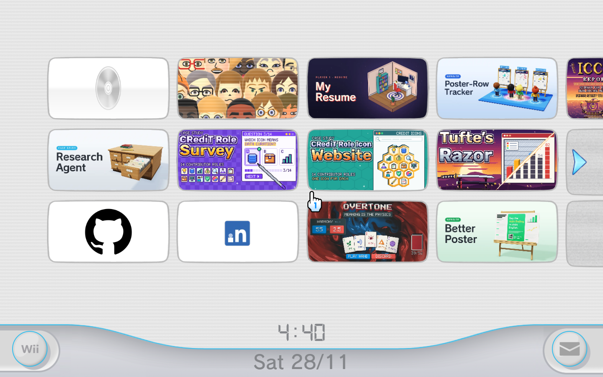
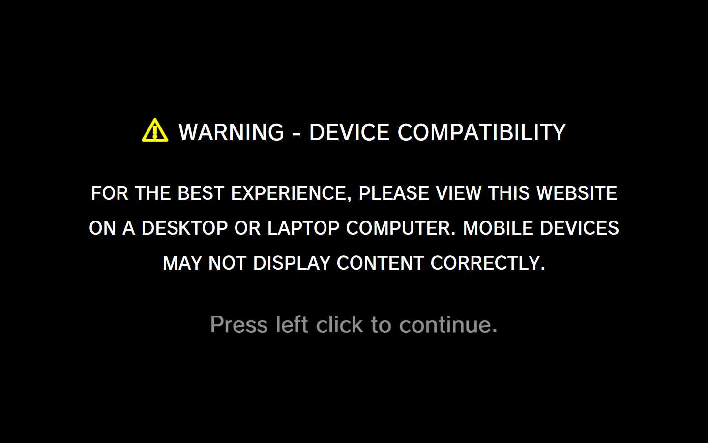
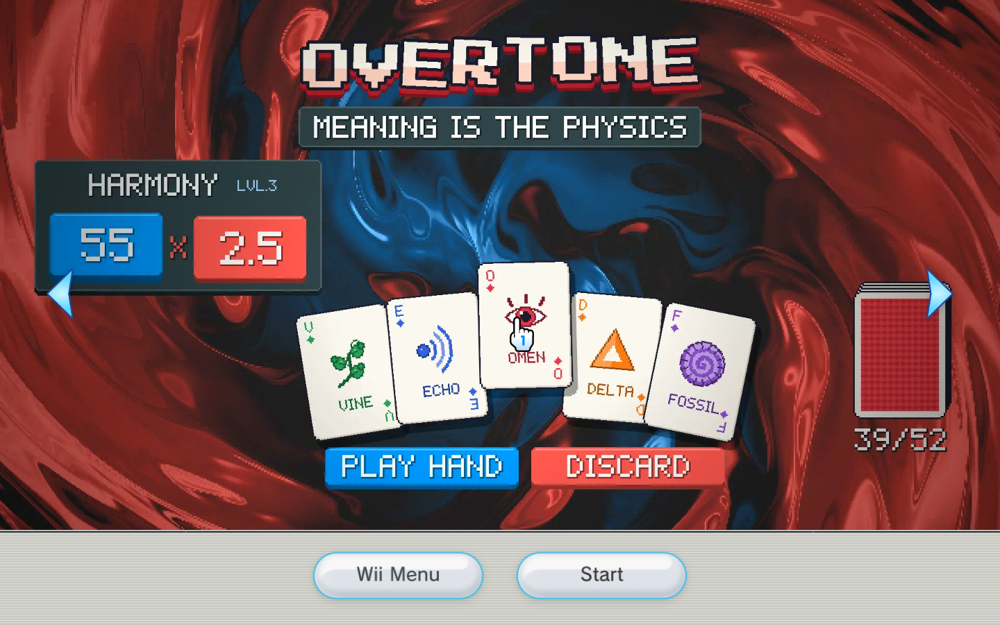

<div align="center">
  
  <h1>Adi's Portfolio</h1>
  <p>My design portfolio. It looks and works like the Wii Menu.</p>
  <a href="https://akiraux.web.app"><strong>akiraux.web.app</strong></a>
  <br /><br />
  
</div>

---

## What it is

This site is a copy of the Wii Menu, made in React. Each channel holds one item: a case study, a project, a link or my resume.

1. The site starts with a warning screen. Click to continue.
2. The menu shows a grid of channels. Click a channel to open it.
3. The channel screen shows the channel art and plays its music.
4. Click **Start** to open the project. Click **Wii Menu** to go back.

Right-click anywhere to open the Home menu.

<p align="center">
  
  
</p>

---

## Channels

| Channel | Start does this |
|---|---|
| Disc Channel | Nothing. It plays the disc sound and animation. |
| Mii Channel | Opens a card with information about me. |
| Resume | Opens my resume. |
| Poster-Row Tracker | Opens the Poster-Row Tracker site. |
| Research Agent | Opens the case study in Figma. |
| Credit Survey | Opens the case study in Figma. |
| Credit Website | Opens the article on Medium. |
| Tufte's Razor | Opens the app. |
| GitHub | Opens my GitHub profile. |
| LinkedIn | Opens my LinkedIn profile. |
| Overtone | Opens the game. |
| BetterPoster | Opens the poster templates site. |
| ICCA Report | Opens a form. The report is not public, so you send an email to get the PDF. |

---

## Stack

- React 19 and Vite 7
- Howler.js for all sound: effects, channel music and menu music
- Plain CSS. No UI library.
- Wii fonts: FOT-Rodin and Continuum
- Hosting: Firebase Hosting (`akiraux` site) and Vercel

---

## Run it on your computer

You must have Node.js installed.

```bash
cd wii-portfolio-react
npm install
npm run dev
```

Open `http://localhost:5173`.

Other commands:

```bash
npm run build    # make the production build
npm run lint     # run ESLint
npm run preview  # show the production build
```

---

## Folders

```
wii-portfolio-react/
├── art-src/             # Scenes for the channel art, and render.py
├── public/
│   ├── assets/          # Menu images, cursor, buttons, channel art
│   ├── audio/           # Sound effects and music
│   ├── channelart/      # HTML for each channel tile
│   └── fonts/           # FOT-Rodin, Continuum, Digital-7
└── src/
    ├── components/      # Screens: warning, menu, channel, Home menu, settings
    ├── context/         # Sound, channel list, settings
    └── hooks/           # Date and time
```

---

## Add or change a channel

Each channel is one object in `src/context/ChannelsContext.jsx`:

```js
{
  id: 'tuftes-razor',
  title: "Tufte's Razor",
  assets: 'assets/channels/',   // folder for the channel art and music
  channelart: 'channelart/',    // folder for the tile HTML
  target: 'https://...',        // Start opens this URL
  action: 'open-paper',         // optional: opens the Mii card
  mobileart: true               // optional: has tall art for phones
}
```

How the art works:

- The menu tile shows `/channelart/{id}/channel.html` in an iframe.
- The channel screen shows the `video` image in `/assets/channels/{id}/`.
- On phones, channels with `mobileart` show `video-mobile.webp`.
- The scenes in `art-src/` make the art. Run `art-src/render.py` to render it.

The browser keeps art files for one year. Each art URL has `ART_VERSION` from `src/channelArt.js`. When you change the art, increase `ART_VERSION`. If you do not, visitors see the old art.

The site keeps the channel list in `localStorage`. When you change the default list, increase the version in the key (now `adifolio-channels-v17`). This resets the list for all visitors.

---

## Deploy

Each push to `main` starts two GitHub Actions:

- `lint.yml` runs ESLint.
- `firebase-hosting.yml` builds the site and deploys it to Firebase Hosting. You can also start it by hand from the Actions tab.

The Firebase deploy needs the repository secret `FIREBASE_SERVICE_ACCOUNT`. This secret is the JSON key of a service account for the `wii-portfolio-adi` project. If the secret is missing, the deploy does not run.

Vercel deploys each push to `main` without more setup.
